# DishonoredCraft

Corvo Attano's powers, folding blade, pistol, crossbow, grenades and spring razors in Minecraft (Forge 1.20.1), with
Dishonored's own first-person arms and animations, sounds, HUD, weapon wheel, stealth and takedowns.

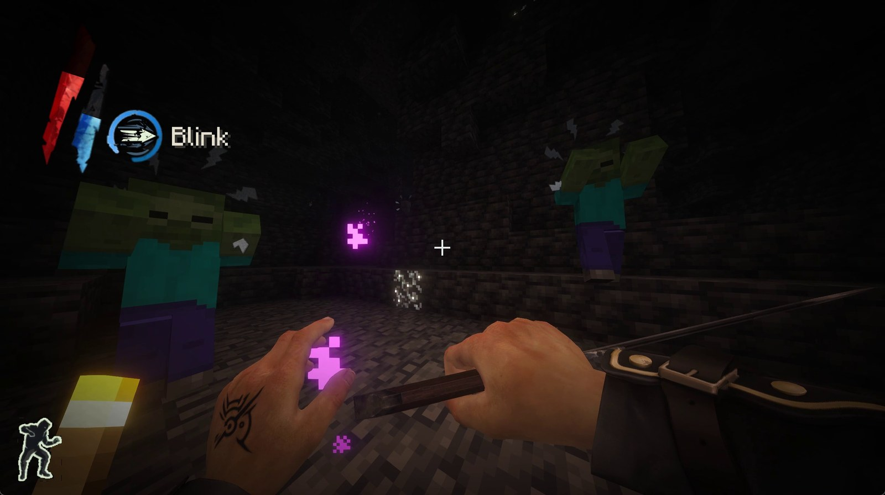

> **Unofficial fan mod.** Not affiliated with or endorsed by Arkane Studios, Bethesda, ZeniMax or Mojang.
> Dishonored © ZeniMax Media / Arkane Studios. Minecraft © Mojang Studios / Microsoft.

## Requirements

- **Dishonored** (the 2012 game) installed through **Steam**. The setup builds the mod's art, animations and sounds
  from your own copy, so it has to be installed while you install or update DishonoredCraft.
- **Minecraft Java Edition** and a modding launcher: **CurseForge**, **Prism Launcher** or **MultiMC**.
- Windows 10/11 and about 1 GB of free space while installing.

## Install

1. Download the newest `DishonoredCraft Setup` zip from [Releases](../../releases) and extract all of it.
2. **Close CurseForge** if you use it (the setup changes its profiles; it tells you if it's still open).
3. Run **Setup DishonoredCraft.exe**. It finds Dishonored through Steam, then asks where the mod goes:
   - **Create DishonoredCraft (CurseForge)**: a new profile with Forge 1.20.1, DishonoredCraft, the Mark of the
     Outsider as its picture and DishonoredCraft's key layout (toggle crouch on C, the mouse side buttons for the
     wheel and blocking);
   - **Use** one of your own Forge 1.20.1 profiles;
   - **Choose another location**: any mods folder.
4. It builds `DishonoredCraft-1.0.jar` into that profile (a couple of minutes). Command windows may flash while it
   runs; that is normal. Press **Open CurseForge** and play the profile.

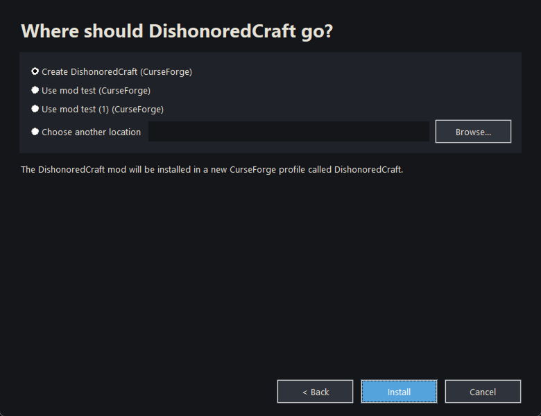

To update, run the new setup and pick the same profile: it replaces the jar and keeps your worlds and settings.

## Gameplay

### Powers (right click with the blade in hand)

| Power | What it does |
|---|---|
| **Blink** | Hold to aim, release to teleport (15 blocks). Aim at a wall below a ledge (up to 2 blocks above where you aim) and Blink mantles you onto it: an arrow of particles on the wall shows it. |
| **Dark Vision** | See creatures through walls (needs 25 mana to switch on, then drains slowly) |
| **Bend Time** | Freezes everything but you. Cast again to end it early: the unused mana flows back |
| **Possession** | Ride inside a mob for 20 seconds. Cast again to leave early (unused mana flows back) |
| **Devouring Swarm** | A swarm of plague rats that hunts hostile mobs |
| **Windblast** | A cone of wind (10 blocks): 4 damage, strong knockback, deflects projectiles, breaks glass and leaves |

Mana refills by itself only up to the cost of one Blink. **Piero's Spiritual Remedy** fills it.

### Weapons and gadgets

- **Folding blade.** Unbreakable, 4 blocks of reach. Hold left click on a block to cut it (one block per swing, as
  the blade lands). Mouse back blocks.
- **Pistol** (600 shots) and **wrist crossbow** (800 shots) with bolts, sleep darts and incendiary bolts (**V**
  switches). **Grenades** and **spring razors** are thrown from the left hand.
- **The blade stays out** while a gun or gadget is in your left hand: left click slashes, mouse back blocks,
  right click fires or throws.
- In third person, and for other players, every weapon and gadget is Dishonored's own model.

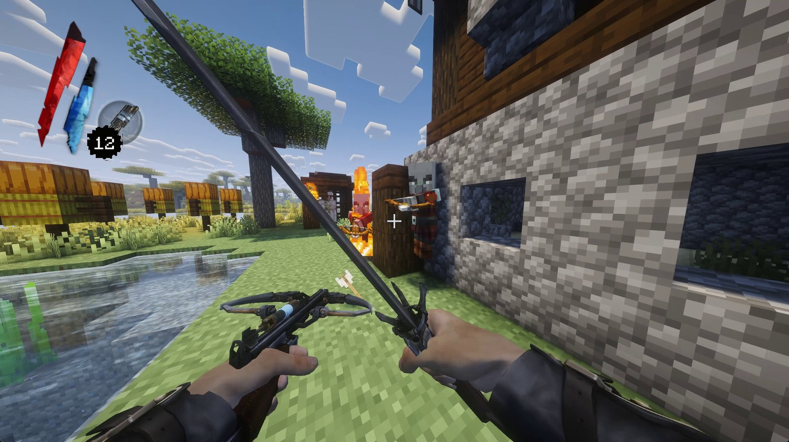

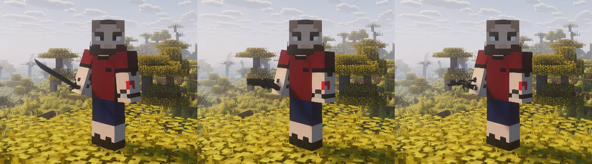

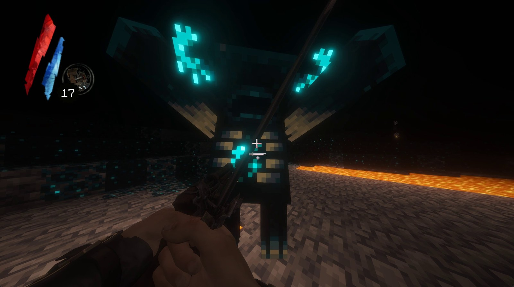

### The weapon wheel

Hold **mouse forward**: powers along the bottom, weapons and ammo over the top with their counts, all in Dishonored's
own icons. Time slows while it's open. Picking a power also draws the blade.

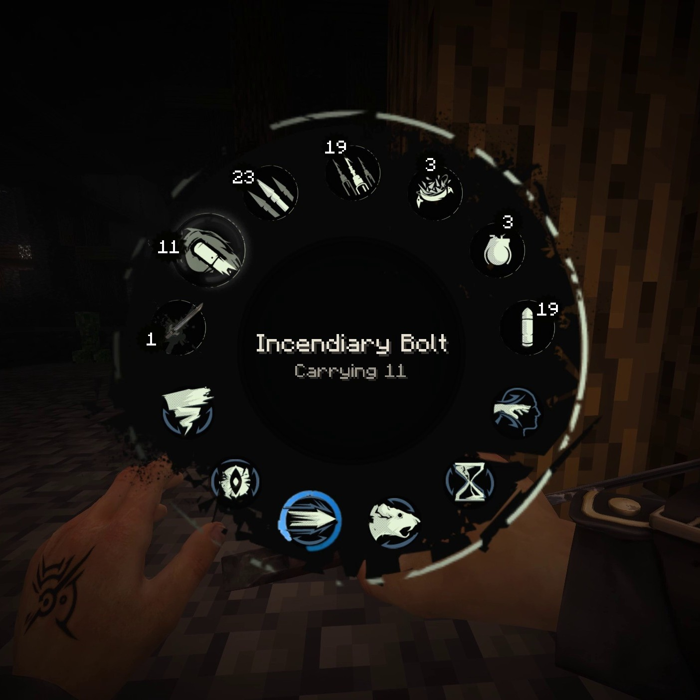

### Stealth and takedowns

- **Detection gauge.** Hostile mobs notice you over time, shown by Dishonored's lightning-bolt marker above their head.
  Crouching, staying out of sight, being above them and moving slowly all help. Endermen spot you the moment you meet
  their eyes.
- **Backstab** an unaware mob from behind (left click), **choke** it unconscious (mouse back), or **drop assassinate**
  it by attacking while falling onto it. A mob that has noticed you can only be drop assassinated.
- Bosses (Ender Dragon, Wither, Warden) can't be taken down.

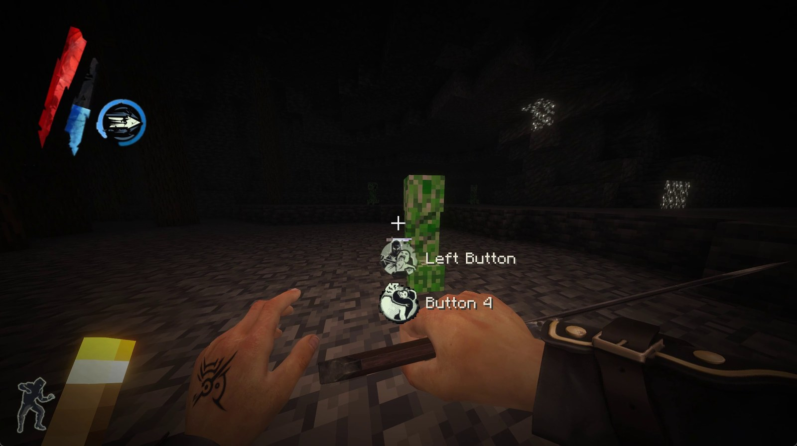

### Movement

- **Mantle:** hold jump while walking into a ledge up to 3 blocks above your feet.
- **Slide:** tap crouch while sprinting.
- **Double jump** (Agility), **lean** around corners (Ctrl + A / D, you stay in place), **edge protection** while
  crouched (**B** turns it on / off).

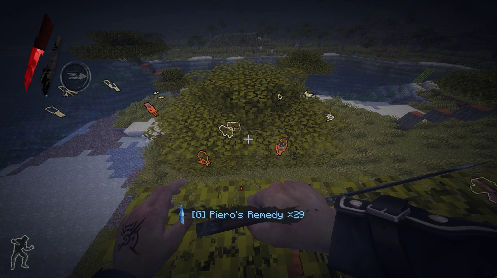

### Bone charms

Six charm slots behind the **Mark of the Outsider** in your inventory (shift-click a charm to equip it). Enemies
sometimes drop one (1%).

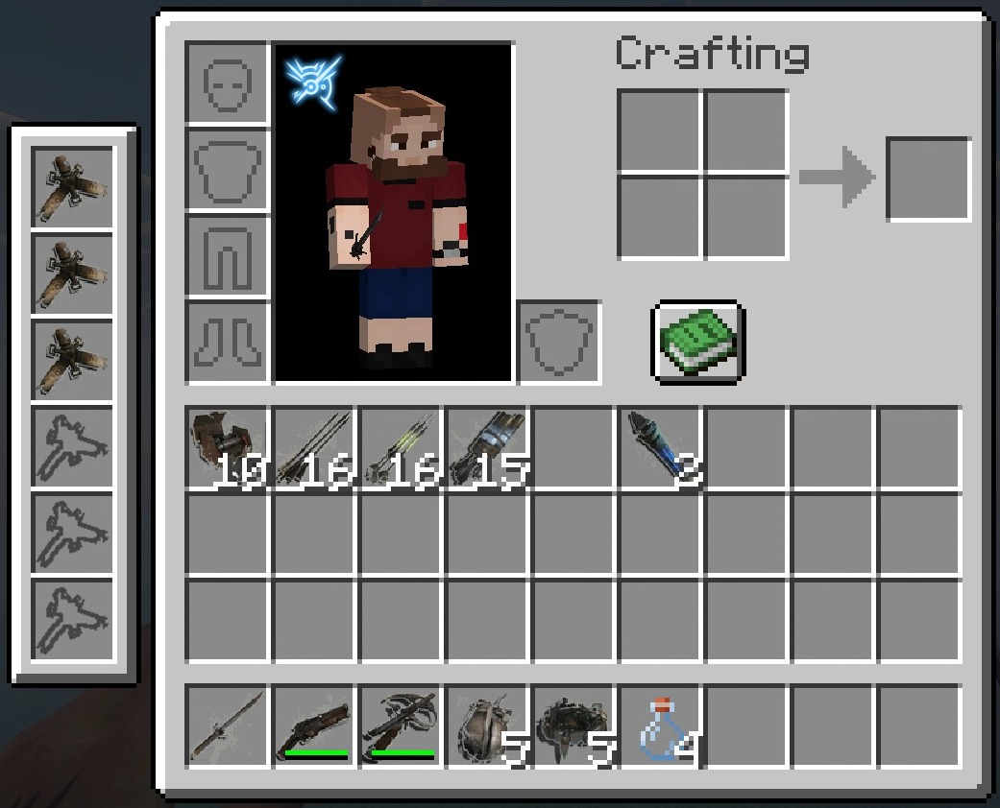

| Charm | Effect |
|---|---|
| Redirective Blink | Time stops while you aim Blink and stand still |
| Falling Star | A drop assassination restores 20% mana |
| Scavenger | 50% chance of double ammo from pickups |
| Spiritual Pool | Mana regenerates faster |
| Strong Arms | Chokes are faster |
| Swift Shadow | Faster crouch-walking |
| Welcoming Host | Possession lasts 30 seconds |
| Whirlwind | Faster sword swings |

### Survival changes

No hunger: food heals you slowly instead, and health doesn't regenerate by itself (**Sokolov's Elixir** heals).
You keep your inventory when you die. Hostile mobs drop pistol shot, bolts, elixirs, darts, gadgets and bone charms.

## Keys

Change them under **Options > Controls > Key Binds > DishonoredCraft**.

| Action | Key |
|---|---|
| Use power (blade in hand; hold to aim Blink) | Right click |
| Block / choke | Mouse back button |
| Weapon wheel (hold) | Mouse forward button |
| Next / previous power | X / Z |
| Cancel Blink | F |
| Lean | Left Ctrl + A / D |
| Drink Sokolov's Elixir / Piero's Remedy | R / G |
| Switch crossbow bolt | V |
| Crouch edge protection on / off | B |

## Crafting recipes

<table>
<tr>
<td align="center">Folding blade 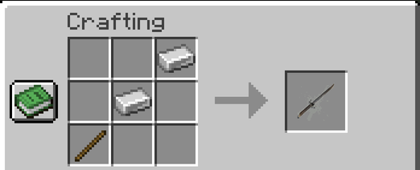</td>
<td align="center">Pistol 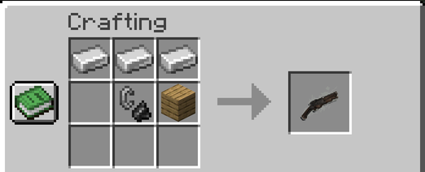</td>
</tr>
<tr>
<td align="center">Wrist crossbow 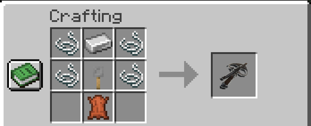</td>
<td align="center">Grenade (x2) 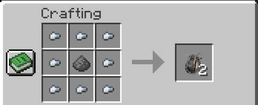</td>
</tr>
<tr>
<td align="center">Spring razor (x2) 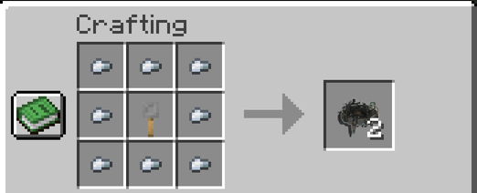</td>
<td align="center">Sokolov's Elixir 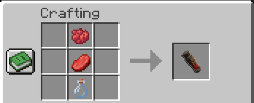</td>
</tr>
<tr>
<td align="center">Piero's Spiritual Remedy 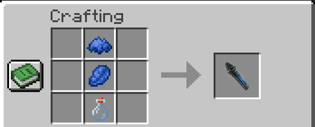</td>
<td></td>
</tr>
</table>

**Ammo** (side by side as shown, or stacked vertically either way up; bolts also work diagonally):

<table>
<tr>
<td align="center">Pistol shot (x4) 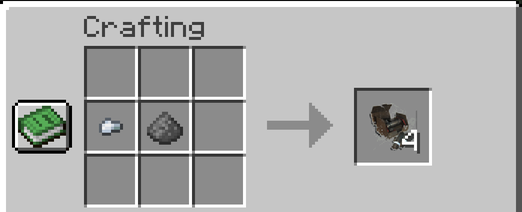</td>
<td align="center">Crossbow bolt (x4) 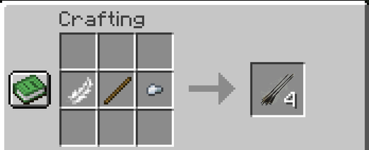</td>
</tr>
<tr>
<td align="center">Sleep dart 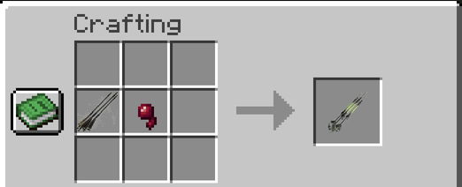</td>
<td align="center">Incendiary bolt (blaze powder or coal) 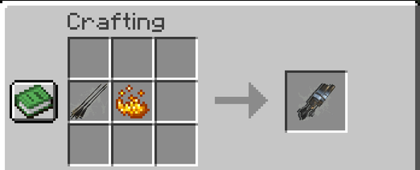</td>
</tr>
</table>

**Bone charms**: bones top left, top right and bottom left, the charm's item in the middle:

<table>
<tr>
<td align="center">Redirective Blink (diamond) 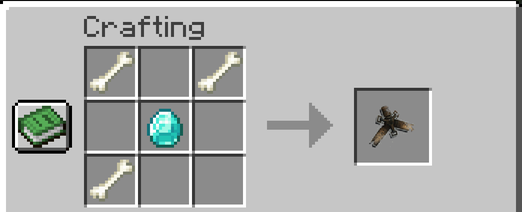</td>
<td align="center">Falling Star (feather) 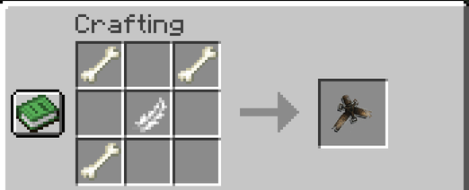</td>
</tr>
<tr>
<td align="center">Scavenger (gunpowder) 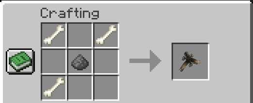</td>
<td align="center">Spiritual Pool (lapis lazuli) 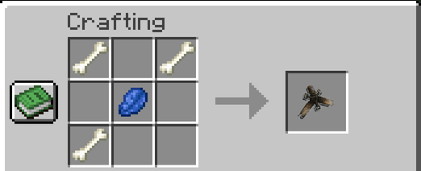</td>
</tr>
<tr>
<td align="center">Strong Arms (iron ingot) 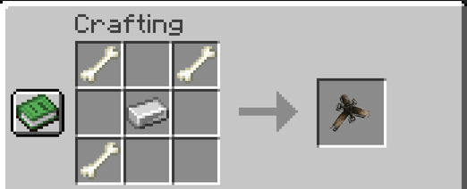</td>
<td align="center">Swift Shadow (sugar) 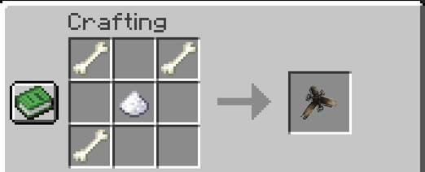</td>
</tr>
<tr>
<td align="center">Welcoming Host (rotten flesh) 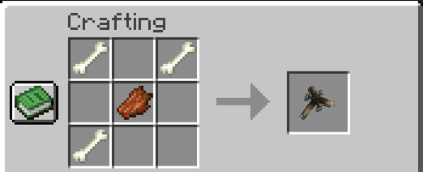</td>
<td align="center">Whirlwind (blaze rod) 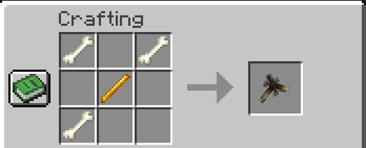</td>
</tr>
</table>

## Fine tuning: `config/dishonored_hands.properties`

A text file in your profile's `config` folder. Open it with Notepad, change a number and save: the game updates
within a second.

| Settings | What they change |
|---|---|
| `hudscale`, `hudpadleft`, `hudpadtop` | Size and position of the health / mana / power corner |
| `vignettezoom` | How thin the dark screen edges are (crouched, low health) |
| `tp_<weapon>_s / rx / ry / rz / x / y / z` | Size, rotation and position of each weapon or gadget in third person |
| `sword…`, `block…` | The blade's grip in first person |

## Made and tested by people and Claude, not by generative AI slop

- **No generative AI was used for any visual or audio asset.** Every arm, animation, weapon, texture, icon, HUD
  element and sound in DishonoredCraft is Dishonored's own, converted from your own install by the setup. The jar it
  builds contains nothing else.
- **The code and this description were written with [Claude Code](https://claude.com/claude-code)** (Anthropic),
  under the author's direction, and went through intensive human testing and tuning.

## No game files here: bring your own

This repository holds **code only**: no Dishonored files and nothing converted from them. The setup builds the
mod's Dishonored content on your PC from **your own** Dishonored install. The jar it builds contains Dishonored's art
and sounds, so it is for you only: please don't share it; share the setup instead.

## What's in here

| Folder | What |
|---|---|
| `src/` | the mod (Forge 1.20.1, Java): powers, weapons, first-person rig, HUD, stealth, takedowns, bone charms |
| `tools/assets/`, `tools/re/` | the extraction pipeline the setup runs: UE3 package unpacking, Wwise sounds, meshes, HUD art, and Dishonored's animations (decoded by running the game's own decoder from your Dishonored.exe in the Unicorn emulator) |
| `installer/` | the setup: wizard (Python / tkinter), engine, package builder, Rust launcher |
| `docs/images/` | the screenshots on this page |

Building from source: the mod with `./gradlew build` (JDK 17); the setup with `python installer/build_package.py --zip`
(Python 3.12 with numpy, scipy, Pillow, pefile and unicorn; the launcher with
`cargo +stable-x86_64-pc-windows-gnu build --release` in `installer/launcher`).

## Credits

See [CREDITS.txt](installer/licenses/CREDITS.txt): UE Viewer (umodel), vgmstream, wwiser, FFmpeg, Python and its
libraries, Unicorn, Minecraft Forge. The setup's icon is by the author.

The screenshots were taken with [Complementary Shaders: Unbound](https://www.complementary.dev/) (r5.9.3) by EminGT, running
through [Oculus](https://www.curseforge.com/minecraft/mc-mods/oculus) and [Embeddium](https://www.curseforge.com/minecraft/mc-mods/embeddium). They are not part of DishonoredCraft.

Code: all rights reserved, StanleyMOV.
